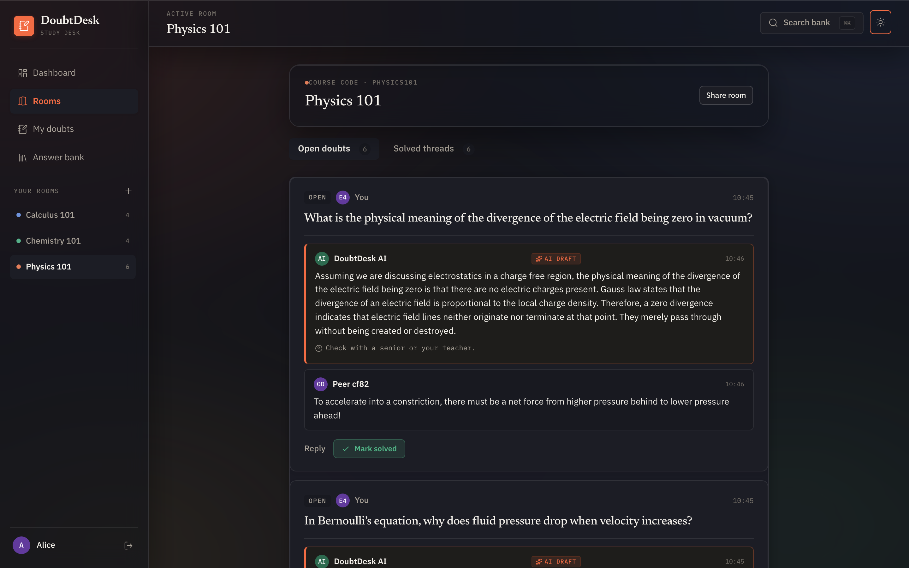
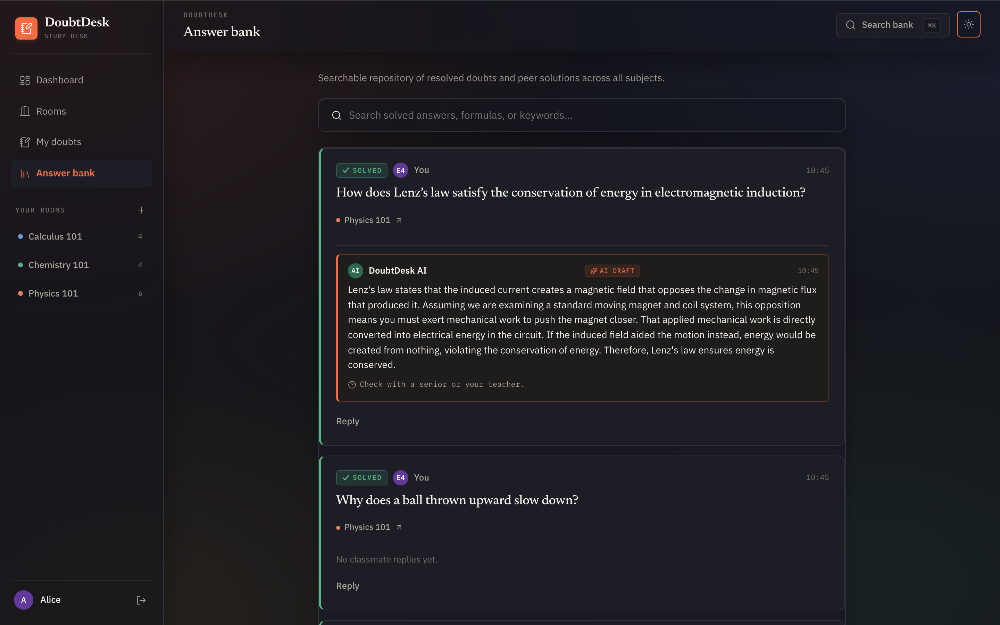
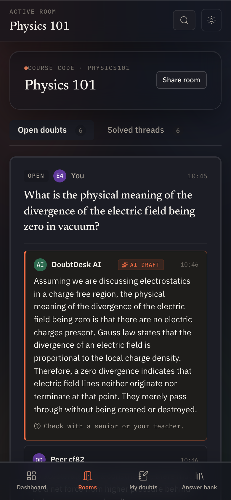
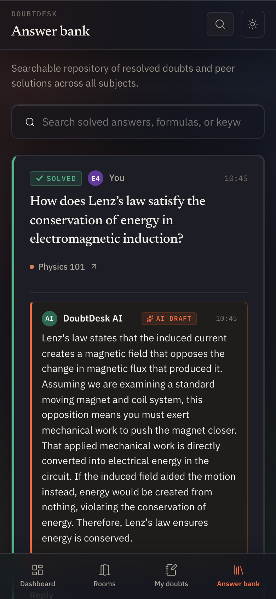

# DoubtDesk

**Live Application:** [https://doubtdesk-silk.vercel.app](https://doubtdesk-silk.vercel.app)

> A campus study chat built for the **Nexconn Build Challenge 2026** where every question becomes a tracked, resolved thread instead of disappearing into an endless group chat.

---

## The Problem

In busy college group chats (WhatsApp, Discord, Telegram), academic questions get asked, pushed off the screen within minutes by banter, and buried forever. The same doubts get repeated weekly before exams, and students cannot easily tell which explanations were verified or resolved.

## The Solution

DoubtDesk organizes study discussions into **subject rooms** where:
1. **Every doubt has a lifecycle:** Questions start as `open` and are marked `solved` when resolved by the asker.
2. **Instant AI first response:** Gemini AI generates a concise, verified first answer within seconds, citing that students should verify with peers or teachers.
3. **Peer collaboration in real time:** Classmates reply in threaded context with live WebSocket updates.
4. **Permanent Answer Bank:** Every resolved question feeds a searchable room knowledge base that students can filter and reference across semesters.

---

## Screenshots

| Desktop Study Room (Dark) | Desktop Answer Bank (Dark) |
| :---: | :---: |
|  |  |

| Mobile Study Room | Mobile Answer Bank |
| :---: | :---: |
|  |  |

---

## How We Use the Nexconn SDK

DoubtDesk integrates the official **Nexconn Chat SDK** (`@nexconn/chat-sdk` connecting to the Singapore data center) and Server APIs strictly according to specifications:

1. **Client Engine Initialization & Connection:**
   - `NCEngine.initialize({ appKey })` is called once on boot.
   - Handlers (`ConnectionStatusHandler`, `MessageHandler`) are registered *before* `NCEngine.connect({ token })`.
   - Automatic background reconnection handles network drops.

2. **Group Channels (`GroupChannel`):**
   - **Creation:** `GroupChannel.createGroup` or backend Server API `/v4/group-channel/create` with `permissions: { joinPerm: 1 }` so any student with the room code can enter.
   - **Joining:** `new GroupChannel(id).join()` allows students to join public subject rooms.
   - **Sending:** `new GroupChannel(id).sendMessage(new SendTextMessageParams({ text, metadata }))` posts doubts and replies.

3. **Real-time Message & Event Handling (`MessageHandler`):**
   - `onMessageReceived` captures incoming doubts and peer replies across active channels without polling.
   - `onMessageMetadataUpdated` streams real-time status transitions (e.g., when an asker marks a doubt as `solved`), updating peer views instantly.

4. **Message History Query (`BaseChannel.createMessagesQuery`):**
   - Loads paginated room history on entrance and powers the search index.
   - Orders messages by server-authoritative `sentTime`.

5. **Message Metadata for Question Lifecycle:**
   - Doubt model: `kind: 'doubt'`, `status: 'open'` | `'solved'`.
   - Reply model: `kind: 'reply'`, `replyTo: <messageId>`, optional `author: 'ai'`.
   - Asker updates metadata via `message.setMetadata({ status: 'solved' })`.
   - History metadata maps are converted via `Object.fromEntries(message.metadata)`.

6. **Secure Server API Token Issuance:**
   - Client never holds the `NEXCONN_APP_SECRET`.
   - The backend issues tokens via `POST https://api.sg-light-api.com/v4/auth/access-token/issue` (with automatic failover to `api-b.sg-light-api.com`), signing requests with SHA1(`AppSecret + Nonce + Timestamp`).
   - Generates deterministic, collision-resistant student IDs based on HMAC-SHA256 of display names.

---

## Architecture Overview

```text
React 18 + TypeScript (Vite)
  │
  ├── Nexconn Chat SDK (Client)
  │     ├── GroupChannel (rooms, joins, messages)
  │     ├── BaseChannel.createMessagesQuery (history)
  │     └── MessageHandler (real-time messages & metadata updates)
  │
  └── Serverless API (Node.js / Vercel Functions / server.mjs)
        ├── POST /api/login          ──> Issues Nexconn token via Server API + signed HMAC session
        ├── POST /api/rooms/create   ──> Creates open group channel via Nexconn Server API
        ├── POST /api/ask            ──> Gemini API with fast-model fallback and rate limiting
        └── GET  /api/health         ──> Health and configuration check
```

- **Security & Privacy:**
  - Secrets (`NEXCONN_APP_SECRET`, `GEMINI_API_KEY`) reside exclusively in server environment variables.
  - Session tokens use HMAC-SHA256 signatures with 12-hour expiration, verified on every protected API call.
  - Strict CORS origin validation accepts same-origin requests and configured domains.
  - User-submitted text is always escaped and rendered as text nodes to prevent XSS.

---

## Local Development

### Requirements
- Node.js 20+
- Nexconn App Key and Secret (Singapore cluster)
- Google Gemini API Key

### Setup Instructions

1. Clone the repository:
   ```sh
   git clone https://github.com/avomaly/doubtdesk.git
   cd doubtdesk
   ```

2. Configure environment files:
   - Copy `.env.example` to `.env`:
     ```env
     VITE_NEXCONN_APP_KEY=your_nexconn_app_key
     ```
   - Copy `.env.server.example` to `.env.server`:
     ```env
     NEXCONN_APP_KEY=your_nexconn_app_key
     NEXCONN_APP_SECRET=your_nexconn_app_secret
     GEMINI_API_KEY=your_gemini_api_key
     GEMINI_MODEL=gemini-3.5-flash-lite
     CORS_ORIGIN=http://localhost:5173,http://127.0.0.1:5173
     ```

3. Install dependencies and run tests:
   ```sh
   npm install
   npm test
   npm run build
   ```

4. Start both backend API and Vite frontend:
   ```sh
   npm run dev:all
   ```
   Open `http://127.0.0.1:5173` in your browser.

---

## Demo Presets & Reset Script

DoubtDesk comes pre-configured with default subject rooms:
- **Physics 101:** `physics101`
- **Chemistry 101:** `chemistry101`
- **Calculus 101:** `calculus101`

To reset or clear demo room channels via the Nexconn Server API, run:
```sh
node --env-file=.env --env-file=.env.server scripts/reset-demo.mjs
```

---

## License

MIT
